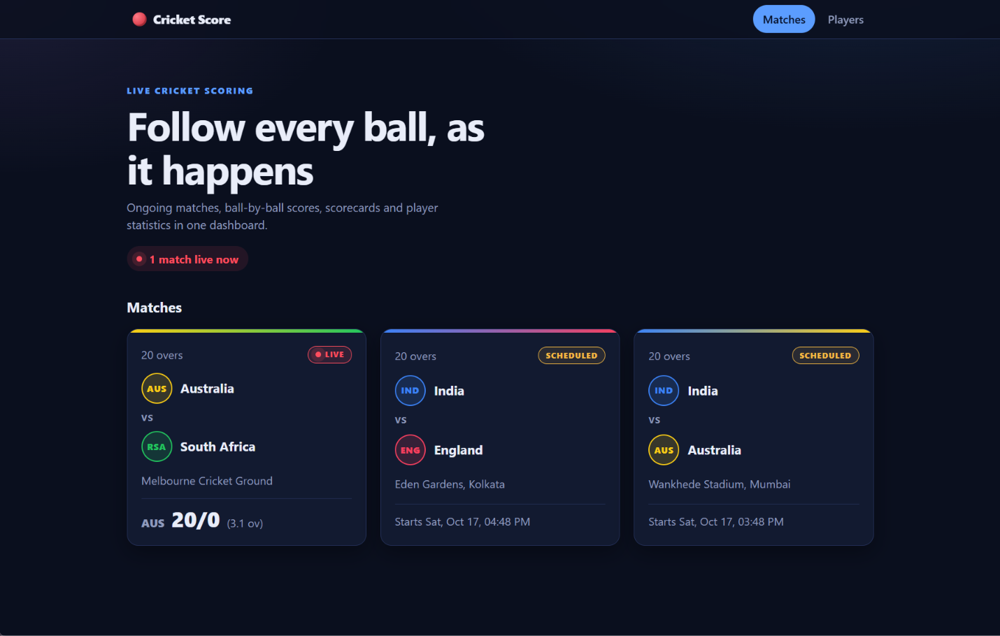
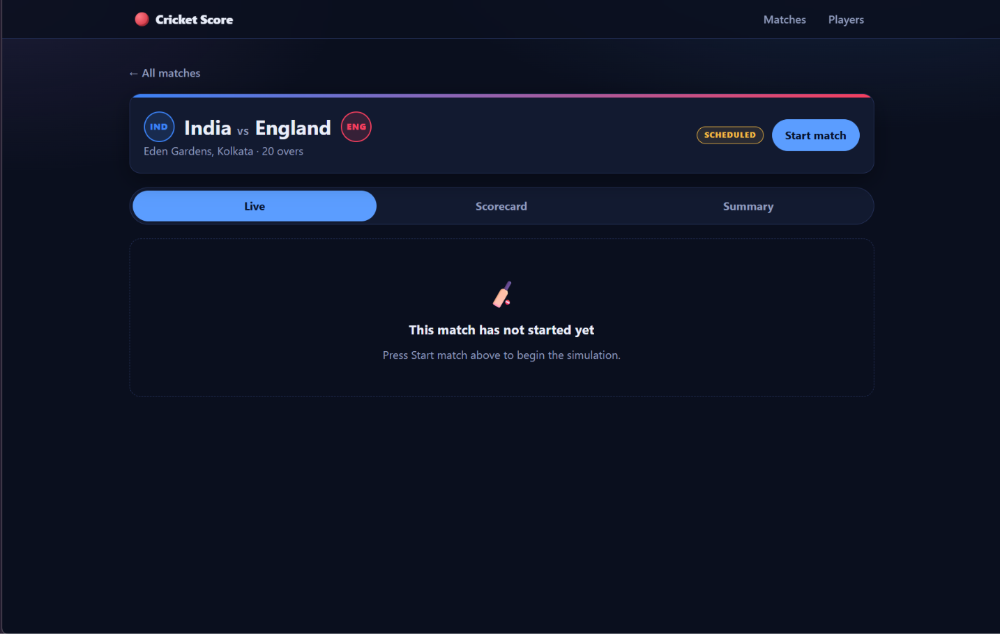
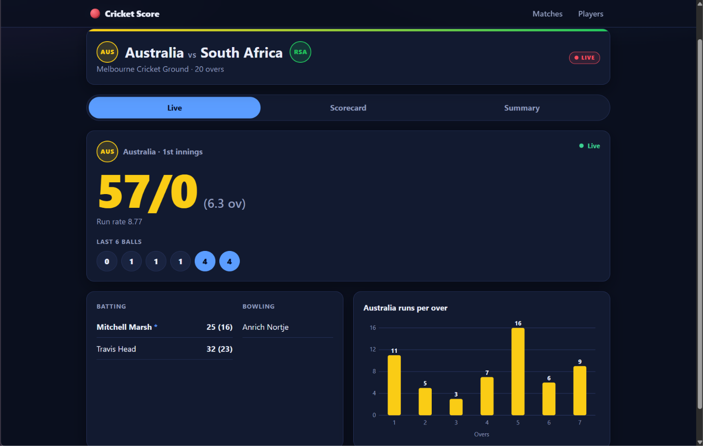
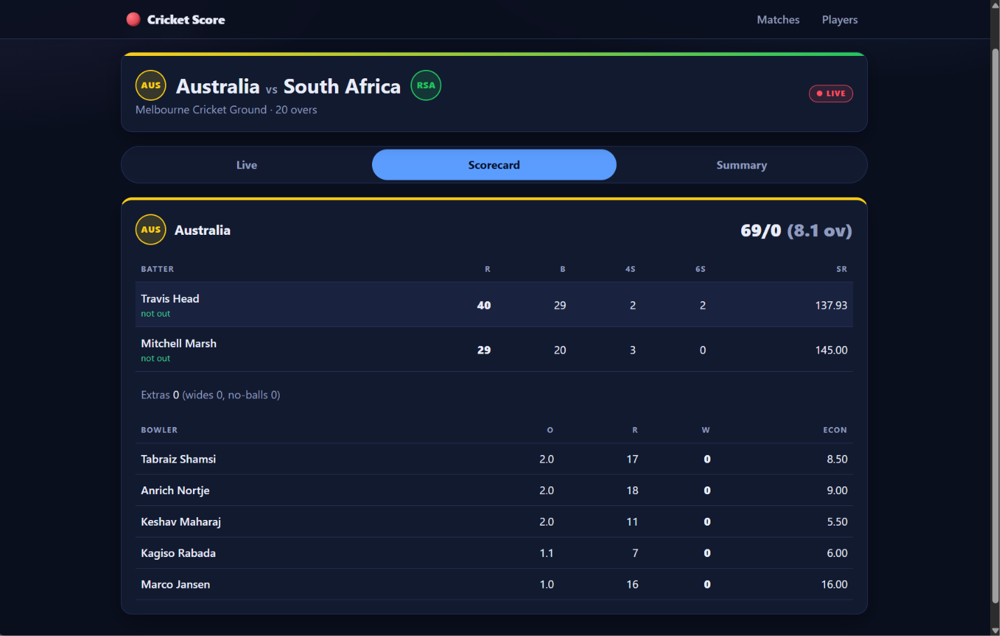
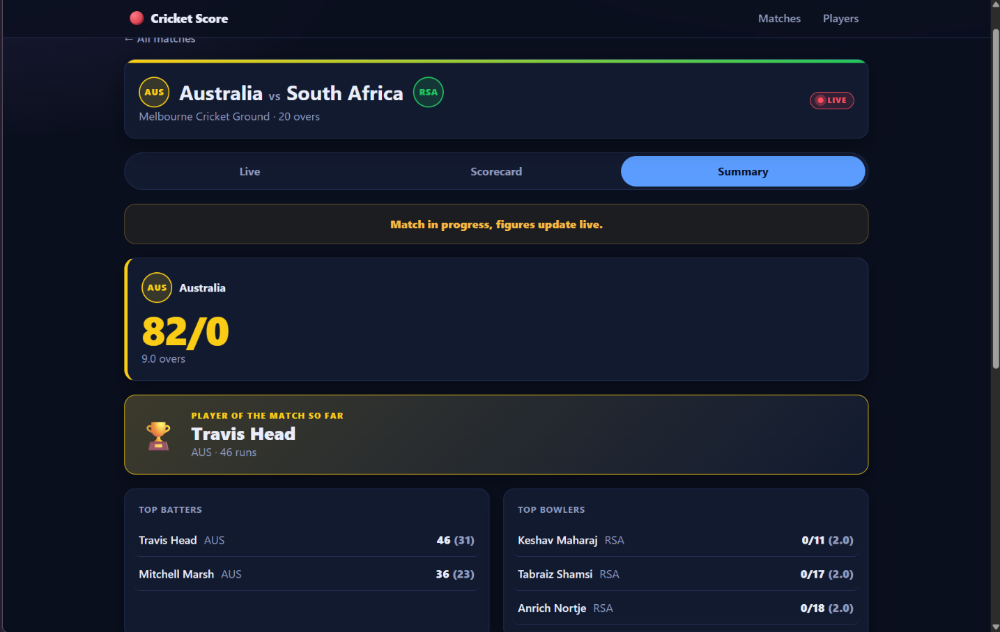
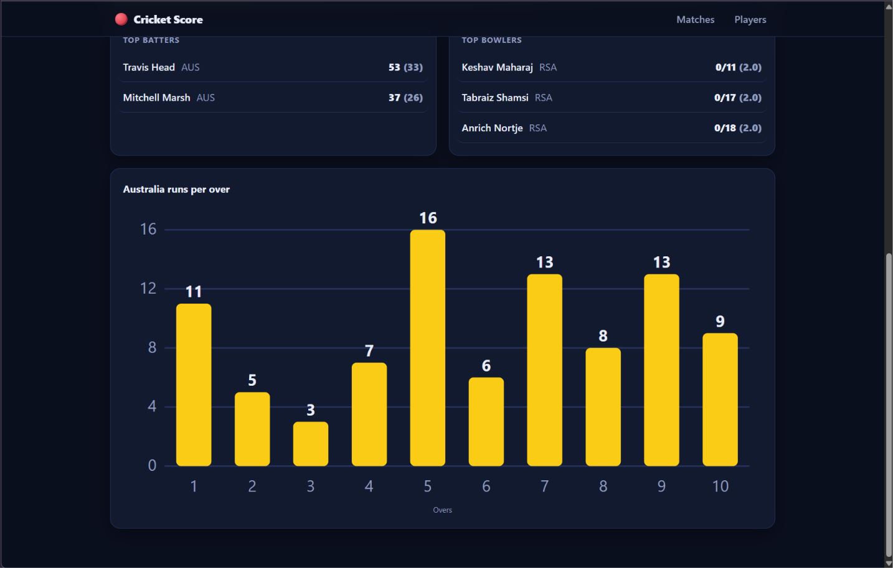
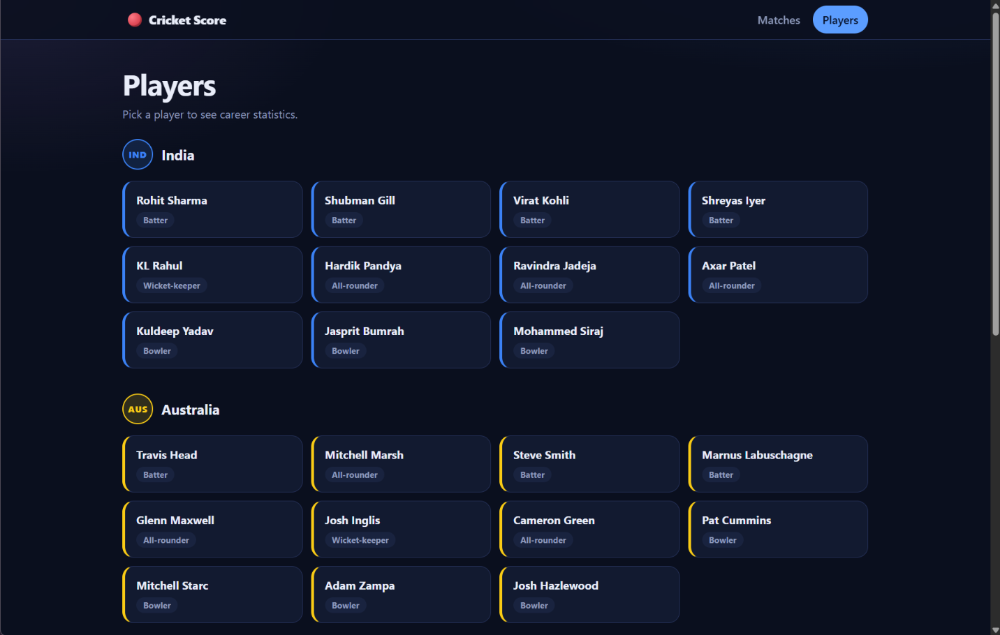

# Cricket Score Management System

A web application that simulates a live cricket scoring platform. Matches are played ball by ball by a built-in simulator, the score is pushed to the browser as it changes, and scorecards, player statistics and match summaries are calculated from the recorded balls. The backend is a Spring Boot REST API with a MySQL database, and the frontend is a responsive React + TypeScript dashboard.

## Project Statement

> Build a Spring Boot project that simulates a live cricket scoring platform: ongoing matches, ball-by-ball score updates, player statistics, and match summaries, exposed through REST APIs and a responsive React + TypeScript dashboard.

## Features

### Matches
- List of all matches with teams, venue, status (SCHEDULED, LIVE, COMPLETED) and result
- Four seeded teams and three seeded 20-over matches
- Start any scheduled match from the dashboard; several matches can be live at the same time
- A match has two innings. The second innings has a target, and the result is worked out when it ends (win by runs, win by wickets, or tie)

### Live Updates
- A simulator bowls one ball every 3 seconds in every live match
- Scores are pushed to the browser with Server-Sent Events, so the page updates without refreshing
- Live score, run rate, target and runs required, current batters and bowler, and the last six balls
- Runs-per-over bar chart drawn with inline SVG
- Live cards on the home page show their own running score
- A manual endpoint can record a single ball (dot, runs, wicket, wide, no-ball)

### Player Statistics
- All players, grouped by team, with an optional team filter in the API
- Per player: matches, runs, balls faced, fours, sixes, strike rate, wickets, overs bowled, runs conceded and economy
- All figures are calculated from the stored ball events

### Match Summary
- Full scorecard for each innings: batting (runs, balls, fours, sixes, strike rate, how out), bowling (overs, runs, wickets, economy), extras and total
- Summary with the result, both innings totals, top 3 batters, top 3 bowlers and the player of the match
- Runs-per-over charts for each innings

## Technology Stack

**Frontend**
- React 19
- TypeScript (strict mode)
- Vite
- React Router
- CSS (grid and flexbox, no UI library)

**Backend**
- Java 17
- Spring Boot 3.5.16 (Spring Web, Spring Data JPA, Validation)
- Lombok
- Maven (wrapper included)
- JUnit 5 and MockMvc for tests

**Database**
- MySQL (from XAMPP) for running the application
- H2 in-memory database for tests

## Project Structure

```
cricket-management-system/
├── backend/                         Spring Boot Maven project
│   ├── pom.xml
│   └── src/
│       ├── main/
│       │   ├── java/com/cricket/cms/
│       │   │   ├── controller/      REST controllers
│       │   │   ├── service/         scoring, simulator, scorecard, summary, SSE
│       │   │   ├── repository/      Spring Data JPA repositories
│       │   │   ├── model/           JPA entities and enums
│       │   │   ├── dto/             request and response objects
│       │   │   ├── exception/       custom exceptions and error handler
│       │   │   └── config/          CORS and seed data
│       │   └── resources/
│       │       └── application.properties
│       └── test/                    unit and integration tests
├── frontend/                        Vite + React + TypeScript project
│   ├── package.json
│   └── src/
│       ├── components/              small reusable components
│       ├── hooks/                   data loading and SSE hooks
│       ├── pages/                   Home, Match, Players, Player pages
│       ├── api.ts                   all calls to the backend
│       ├── types.ts                 types that mirror the backend DTOs
│       └── index.css                styles
├── screenshots/                     images used in this README
└── README.md
```

## How to Run

### Prerequisites
- JDK 17 or newer
- Node.js and npm
- XAMPP with MySQL started (the database runs at `localhost:3306`, user `root`, empty password)

The database `cricket_db` is created automatically on the first start.

### Start the Backend
Either import `backend/` into Eclipse (or STS) with **File > Import > Maven > Existing Maven Projects** and run `CricketManagementSystemApplication`, or from a terminal:

```
cd backend
./mvnw spring-boot:run
```

The backend runs on http://localhost:8080. Run the tests with `./mvnw test`.

### Start the Frontend

```
cd frontend
npm install
npm run dev
```

Open http://localhost:5173. To check the production build, run `npm run build`.

## API Endpoints

| Method | Endpoint | Description |
| ------ | -------- | ----------- |
| GET | `/api/matches` | All matches, newest start time first |
| GET | `/api/matches/{id}/score` | Current score of a match |
| GET | `/api/matches/{id}/scorecard` | Batting, bowling, extras and total for each innings |
| GET | `/api/matches/{id}/summary` | Result, innings totals, top performers, player of the match, runs per over |
| GET | `/api/matches/{id}/stream` | Server-Sent Events stream, sends a `score` event after every ball |
| POST | `/api/matches/{id}/start` | Starts a scheduled match |
| POST | `/api/matches/{id}/ball` | Records one ball. Body: `{"outcome": "FOUR"}`, with optional `batsmanId` and `bowlerId` |
| GET | `/api/players` | All players. Optional `?teamId=` filter |
| GET | `/api/players/{id}/stats` | Statistics of one player |

Valid `outcome` values are `DOT`, `ONE`, `TWO`, `THREE`, `FOUR`, `SIX`, `WICKET`, `WIDE` and `NO_BALL`.

Errors use one JSON shape: `timestamp`, `status`, `error`, `message` and `path`. A missing match or player gives 404, a match in the wrong state gives 409, and an invalid request body gives 400.

## How to Use

1. Start MySQL, the backend and the frontend as described above.
2. Open http://localhost:5173. The home page lists the matches.
3. Click a match card to open it, then press **Start match**. The status changes to LIVE and the score starts moving every 3 seconds.
4. Use the **Live**, **Scorecard** and **Summary** tabs on the match page.
5. Go back and start a second match. Both live cards on the home page update at the same time.
6. Open **Players** in the navbar and click a player to see statistics.
7. When a match ends, its card shows the result and the Summary tab shows the player of the match.

## Architecture

```
+------------------------+        REST (fetch)         +--------------------------+
|                        | --------------------------> |                          |
|  React frontend        |                             |  Spring Boot backend     |
|  (TypeScript, Vite)    | <-------------------------- |                          |
|  http://localhost:5173 |        SSE (EventSource)    |  controller -> service   |
|                        |                             |  -> repository           |
+------------------------+                             |  simulator (@Scheduled)  |
                                                       |  http://localhost:8080   |
                                                       +------------+-------------+
                                                                    |
                                                                    | JPA / JDBC
                                                                    v
                                                       +--------------------------+
                                                       |  MySQL (cricket_db)      |
                                                       +--------------------------+
```

The simulator and the manual ball endpoint both call the same scoring service, which saves a ball event. Score, overs, scorecards and player statistics are always calculated from the saved ball events, so there is one source of truth. After every ball the score is pushed to the browsers that are watching that match.

## Screenshots

### Home page


### Match not started


### Running match


### Scorecard


### Summary




### Players


## Data Storage

Data is stored in MySQL in the `cricket_db` database. The tables are created automatically by Hibernate:

| Table | Contents |
| ----- | -------- |
| `teams` | Team name and short name |
| `players` | Player name, role and team |
| `matches` | Teams, venue, overs, status, start time and result |
| `innings` | Batting and bowling team, target, current batters and bowler |
| `ball_events` | Every delivery: over, ball, batter, bowler, runs, extras and wicket |
| `player_stats` | Created from the `PlayerStats` entity, but not used. Statistics are calculated from `ball_events` |

Seed data loads on the first run, when the database has no teams: India, Australia, England and South Africa with 11 players each, and three 20-over matches (India vs Australia, India vs England, Australia vs South Africa). To get the seed data again, drop `cricket_db` and restart the backend.

Tests use an in-memory H2 database through the `test` profile, so they never touch MySQL.

## Limitations

- All data is simulated. There is no external cricket API.
- The dismissal text is always "b <bowler>", because a ball event does not store the dismissal type.
- There is no toss. Team A always bats first.
- A manual ball and a simulator ball at the same instant can read the same score.
- There is no authentication. The CORS configuration allows every origin, which is only suitable for development.
- Matches use fixed squads in batting order and cannot be created, edited or reset from the dashboard.

## Future Scope

- Store the dismissal type (bowled, caught, lbw, run out) and the fielder
- Toss and choice of batting or bowling first
- Create teams, players and matches from the dashboard
- Manual scoring screen for recording real matches
- Authentication and roles
- Career statistics across seasons and player comparison

## Author

Academic project — Cricket Score Management System.
